# 👋 Hey, I'm Kunal Bhardwaj

<h3 align="center">
  🚀 Full Stack Developer | AI/ML Explorer | Problem Solver
</h3>

  

  
  
  
  

---

## 🧑‍💻 About Me

- 🌍 Based in India
- 💻 Full-Stack MERN Developer
- 🧠 Exploring Machine Learning, Deep Learning & Generative AI
- 🤖 Learning LLMs, RAG, and AI Agents
- ⚙️ Exploring DevOps: Docker, CI/CD & Kubernetes
- 🧩 C++ & Python Programmer | DSA Enthusiast
- 🤝 Open to collaborating on interesting projects
- 💬 Ask me about Web Development, Programming, and Debugging
- ⚡ Fun fact: I can spend hours debugging a bug caused by a missing semicolon 😄

 

---

## 🛠️ Tech Stack & Tools

### 💻 Programming Languages

  

### 🌐 Frontend Development

  

### ⚙️ Backend Development

  

### 🗄️ Database & Infrastructure

  

### 🔧 Development Tools

  

---

## 🌐 Connect With Me

  
  &nbsp;&nbsp;&nbsp;
  
  &nbsp;&nbsp;&nbsp;
  

---

## 📊 GitHub Statistics

  

---

## 🎮 Pac-Man Contribution Graph

  

---

  

  <b>✨ Thanks for visiting my profile! Let's build something amazing together. ✨</b>

